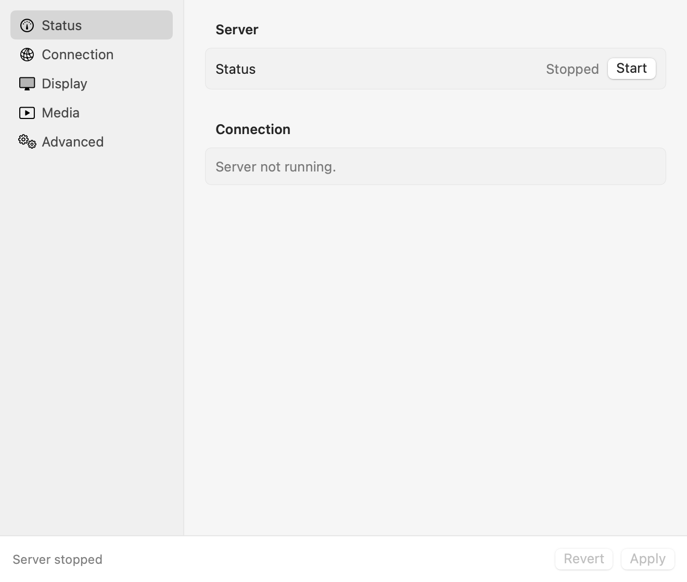
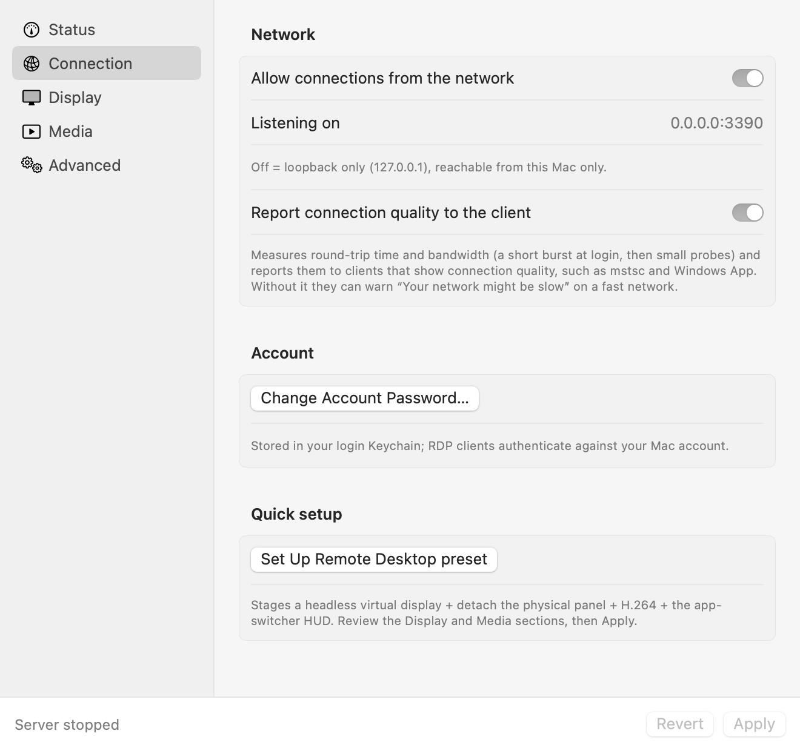
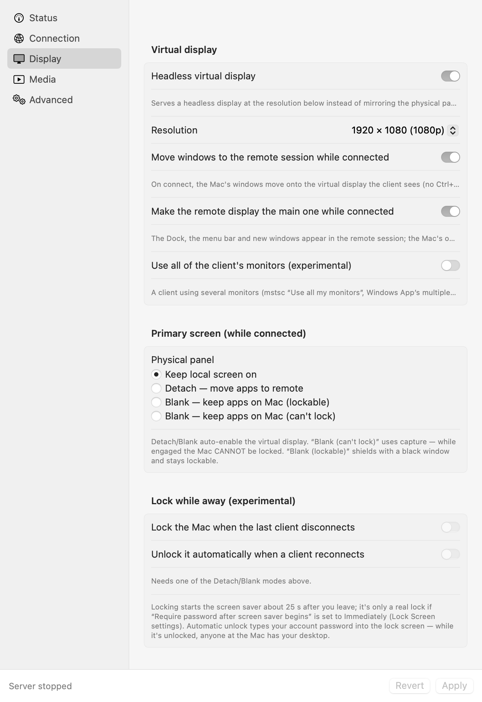
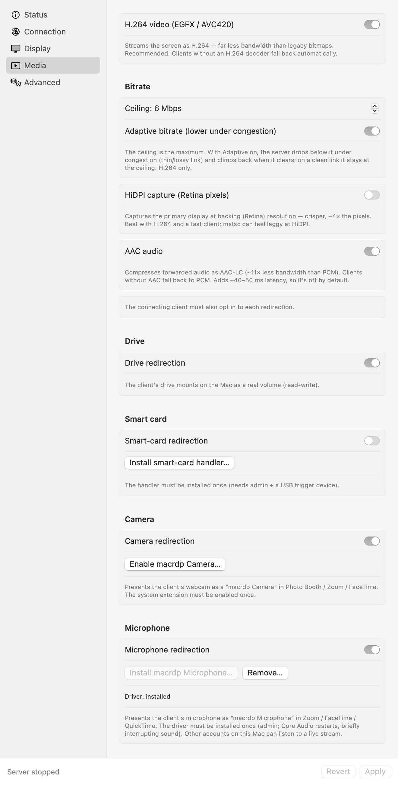
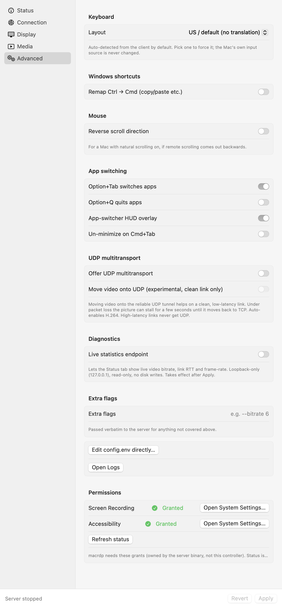

# macrdp user manual

macrdp lets you use your Mac from another computer with Microsoft's Remote Desktop: the
**Windows App** (Windows, macOS, iPhone, iPad, Android), Windows' **Remote Desktop Connection**
(`mstsc`), or **FreeRDP** on Linux. You see the Mac's desktop, type and click on it, hear its
sound, copy and paste between the two, and can bring your own drives, microphone, webcam and
smart card into the session.

This manual covers installing it, connecting, and every setting in the controller. For the
technical detail behind each feature, see the [other guides](../README.md#documentation).

- [What you need](#what-you-need)
- [Install](#install)
- [First start](#first-start)
- [Connect](#connect)
- [The controller](#the-controller)
- [Common setups](#common-setups)
- [Bringing your devices along](#bringing-your-devices-along)
- [Keyboard and shortcuts](#keyboard-and-shortcuts)
- [Troubleshooting](#troubleshooting)
- [Updating and removing macrdp](#updating-and-removing-macrdp)

## What you need

- A Mac with **Apple silicon** (M1 or later), on **macOS 14 Sonoma** or later.
- Your **Mac account's password**: clients log in with your Mac user name and password.
- A client on the other computer: the Windows App, Remote Desktop Connection (built into
  Windows), or FreeRDP.
- To connect from outside your home or office network, a **VPN** (ZeroTier, Tailscale, WireGuard
  or similar). Don't expose the RDP port directly to the internet.

## Install

**With Homebrew:**

```bash
brew tap clintcan/tap
brew trust clintcan/tap
brew install --cask macrdp
```

**Or from the release page:** download `macrdp-<version>-usb.dmg` from the
[latest release](https://github.com/clintcan/macrdp/releases/latest), open it, and drag
**macrdp** and **macrdpController** into **Applications**.

Either way you get two apps:

| App | What it is |
|---|---|
| **macrdp** | The server. It runs in the background; you never open it yourself. |
| **macrdpController** | A menu-bar app to start and stop the server and change its settings. |

## First start

1. Open **macrdpController** from Applications. It's a menu-bar app, so nothing appears in the
   Dock; look for a small **display icon** in the menu bar (dimmed while the server is stopped).
   If you can't see it, it may be hidden behind the notch or by the menu bar settings in
   System Settings.
2. Click the icon and choose **Start (first run sets up)**. macrdp asks for your Mac password,
   keeps it in your login Keychain, and sets itself to start when you log in.
3. macOS asks for two permissions. Turn on **macrdp** under both, in
   **System Settings › Privacy & Security**:
   - **Screen Recording**: to show your screen to the client;
   - **Accessibility**: to pass on the client's keyboard and mouse.

   The controller offers to open the right page. After granting them, choose **Restart** in the
   controller's menu.
4. To accept connections from other computers, open **Show macrdp…**, go to **Connection**, turn
   on **Allow connections from the network**, and click **Apply**. (Off, only this Mac itself can
   connect.)

The server now starts by itself whenever you log in.

> **After a reboot, someone has to log in before you can connect.** macrdp runs inside your user
> session, which only exists once you've logged in. To get in remotely after a reboot, log in
> once with macOS Screen Sharing, then connect with Remote Desktop.

## Connect

You need the Mac's address (in **System Settings › Network**, or your VPN's address for the Mac)
and the port, **3390**. Connect to **`<address>:3390`**, for example `192.168.0.20:3390`.

- **Windows App** (any platform): add a PC with the address `192.168.0.20:3390`, then connect.
  Log in with your **Mac user name** (the short one, as in your home folder) and password.
- **Remote Desktop Connection (mstsc)** on Windows: type `192.168.0.20:3390` as the computer and
  click **Connect**; it asks for the user name and password.
- **FreeRDP** on Linux or macOS:
  `sdl-freerdp /v:192.168.0.20:3390 /u:<mac-user> /gfx:AVC420`

**The certificate prompt.** The first time, the client warns that it can't verify the remote
computer's identity: macrdp uses its own certificate, named after your Mac. Accept it (most
clients let you remember the choice). To be sure you're talking to your own Mac, compare the
fingerprint the client shows with the one in
`~/Library/Application Support/macrdp/cert.pem` (`openssl x509 -in cert.pem -noout -fingerprint -sha256`).

**One person at a time.** macOS has one desktop on screen at a time, so macrdp serves one
session. If you connect from a second computer, it takes over the session and the first one is
disconnected.

**Retina clients.** A Mac, iPad or other high-resolution client looks sharpest with its
"Optimize for Retina displays" (or similar) option on, and macrdp's **HiDPI** setting on
([Display](#display)). Over a slow VPN, leaving that option off is lighter on the link.

## The controller

Click the menu-bar icon for the controller's menu:

| Item | What it does |
|---|---|
| *macrdp — running (pid …)* | The server's state; a warning appears below it if the server can't start. |
| **Show macrdp…** | Opens the settings window. |
| **Start** / **Stop** / **Restart** | Starts or stops the server. The first Start sets everything up. |
| **Re-enter Password…** | Shown if the stored password no longer works (for example after you changed it). |
| **Quit Controller** | Closes the controller; the server keeps running. |

The settings window has five sections. Change what you need and click **Apply**: the server
restarts with the new settings, which drops a connected client for a moment. **Revert** undoes
changes you haven't applied.

### Status



Whether the server is running, with **Start**, or **Restart** and **Stop**. While a client is
connected it shows who, and, with *Live statistics* on (in [Advanced](#advanced)), the video
bitrate, frame rate and network delay.

### Connection



- **Allow connections from the network**: on to accept other computers; off for this Mac only.
- **Report connection quality to the client**: lets Windows clients show the real connection
  quality instead of warning "Your network might be slow". Leave it on.
- **Change Account Password…**: update the stored password after you change your Mac password.
- **Set Up Remote Desktop preset**: one click for the typical unattended setup (a virtual display,
  the Mac's own screen switched off while connected, H.264 video, the app switcher). Review the
  result, then Apply.

### Display



- **Headless virtual display**: the session gets its own display, sized to the client's window,
  instead of showing the Mac's physical screen. Recommended: the client gets a desktop that fits
  it, and someone at the Mac isn't disturbed. **Resolution** is its size before a client connects.
- **Move windows to the remote session while connected**: when you connect, your open windows move
  to the remote display; when you leave, they come back to the Mac's screen.
- **Make the remote display the main one while connected**: the Dock and menu bar move to the
  remote display while you're connected, and come back when you leave.
- **Use all of the client's monitors (experimental)**: with "Use all my monitors" in mstsc, or
  multiple displays in the Windows App, each of your monitors gets its own remote display.
- **Physical panel**: what happens to the Mac's own screen while you're connected:
  - *Keep local screen on*: it stays as it is (the default);
  - *Detach*: it switches off and your apps move to the remote display;
  - *Blank (lockable)*: it's covered with black, and the Mac can still be locked;
  - *Blank (can't lock)*: an older blanking method; while connected, the Mac **can't be locked**.
- **Lock while away (experimental)**: lock the Mac when the last client leaves, and optionally
  unlock it automatically when you reconnect. Needs one of the Detach or Blank modes, and
  "Require password" set to *Immediately* in macOS's Lock Screen settings.

**HiDPI.** In config.env, `VD_HIDPI=auto` gives a Retina client a sharp 2× desktop and other
clients a normal one (see [Configuration](configuration.md)).

### Media



- **H.264 video**: much smoother and lighter on the network than the alternative. Leave it on.
- **Bitrate**: the most video data per second. With **Adaptive bitrate** on, macrdp lowers it
  when the network gets congested and raises it again when it clears; leave that on, especially
  over a VPN.
- **HiDPI capture**: for the Mac's *physical* screen only (without the virtual display): sends its
  full Retina resolution.
- **AAC audio**: compresses the sound (about 11× less data) at the cost of ~40–50 ms more delay.
- **Drive**, **Smart card**, **Camera**, **Microphone**: see
  [Bringing your devices along](#bringing-your-devices-along). The client has to share each one
  too.

### Advanced



- **Keyboard layout**: picked automatically from the client's keyboard; choose one only if it
  guesses wrong. The Mac's own keyboard setting is never changed.
- **Remap Ctrl → Cmd**: Windows habits (Ctrl+C, Ctrl+V, Ctrl+Z…) work as their Mac equivalents.
  Terminals are left alone, so Ctrl+C still stops a program there; add apps with an embedded
  terminal (such as VS Code) to the exception list.
- **Reverse scroll direction**: if scrolling comes out backwards.
- **App switching**: Option+Tab to switch apps (for clients that don't pass the Windows key), Option+Q
  to quit, an on-screen app switcher, and un-minimizing with Cmd+Tab.
- **UDP multitransport**: lets mstsc on the same network use a UDP connection for sound, which
  copes better with a busy link. *Move video onto UDP* is experimental. Slow links (VPNs) stay on
  TCP automatically, and other clients ignore it.
- **Live statistics endpoint**: shows live video figures in [Status](#status).
- **Extra flags**, **Edit config.env directly…**, **Open Logs**: for settings not in the window,
  and for troubleshooting (see [Configuration](configuration.md) for every option).
- **Permissions**: whether macrdp has Screen Recording and Accessibility, with buttons to the right
  System Settings pages.

## Common setups

**A Mac you also use in person.** Display: *Headless virtual display* on, *Keep local screen on*,
*Move windows to the remote session* and *Make the remote display the main one* on. You get your
windows, Dock and menu bar remotely; when you leave, everything comes back to the Mac's screen.

**An unattended Mac (a Mac mini in a cupboard, say).** Use **Set Up Remote Desktop preset** in
Connection, or: *Headless virtual display* on and *Blank (lockable)*. Turn on *Lock while away* if
the Mac could be reached by someone in person. Keep it on power, with the lid open if it's a
laptop: a sleeping Mac doesn't answer connections, and macOS won't stay awake on battery or with
the lid closed (see [Troubleshooting](#troubleshooting)).

**Connecting over a VPN.** Keep *Adaptive bitrate* on. If video is choppy, lower the bitrate
ceiling in Media, or turn off the client's Retina option.

**Several monitors.** Turn on *Use all of the client's monitors*, and in the client choose
"Use all my monitors" (mstsc) or multiple displays (Windows App). Still experimental: a
resolution change takes a few seconds to appear.

## Bringing your devices along

Each device needs its switch on in [Media](#media) **and** sharing turned on in the client, set
before you connect. In mstsc that's **Show Options › Local Resources**; in the Windows App, the
PC's **Edit › Devices & Audio** (names vary a little by platform).

| Device | In macrdp | In the client | On the Mac |
|---|---|---|---|
| **Clipboard** | always on | Clipboard | text, images, rich text and files, both ways |
| **Sound** | always on | Play on this computer | the Mac's sound plays on the client |
| **Drives** | Drive redirection | Drives (pick which) | a volume in Finder, read-write |
| **Microphone** | Microphone redirection + **Install macrdp Microphone…** once | Record from this computer | "macrdp Microphone" in FaceTime, Zoom… |
| **Webcam** | Camera redirection + **Enable macrdp Camera…** once | Video capture devices | "macrdp Camera" in FaceTime, Photo Booth, Zoom… |
| **Smart card** | Smart-card redirection + **Install smart-card handler…** once | Smart cards | usable by Mac apps that support smart cards |
| **USB devices** | in config.env (experimental) | USB devices (mstsc needs a Group Policy setting) | the device appears on the Mac |

Notes:
- **Microphone**: installing the driver needs an administrator password and restarts the Mac's
  sound system briefly. While a session is using it, other user accounts on the same Mac could
  listen in.
- **Webcam**: after **Enable macrdp Camera…**, macOS asks you to allow it: **System Settings ›
  Privacy & Security**, "System software from … was blocked", **Allow**.
- **Smart card**: macOS only loads the handler when a particular USB device is plugged in, so an
  unattended Mac needs one left attached. See [Smart-card redirection](smart-card-redirection.md).
- **USB**: experimental; mass storage and game controllers work. For a webcam, use the camera
  option above instead. Details in [Features](features.md).

## Keyboard and shortcuts

On a Windows keyboard, the Mac's **Cmd** key is the **Windows key**.

| Keys | What they do |
|---|---|
| **Win+Tab** (Cmd+Tab) | Switch apps; also **Option+Tab** with the App switching option on |
| **Win+\`** | Switch windows of the current app |
| **Win+Space** | Spotlight |
| **Win+Shift+3 / 4 / 5** | Screenshots |
| **Ctrl+Alt+G** | Bring windows that ended up off the remote display onto it |
| **Ctrl+Alt+Shift+R** | Refresh the picture and resync the sound, without reconnecting |

> **mstsc:** if Win+Tab does nothing, set **Local Resources › Keyboard › Apply Windows key
> combinations** to **On the remote computer** (or use full screen). Otherwise Windows keeps
> Win+Tab for itself.

## Troubleshooting

**The client can't connect.**
- Is the server running? The menu-bar icon is dimmed when it isn't; choose **Start**.
- Is **Allow connections from the network** on (Connection)?
- Is the Mac asleep? A sleeping Mac doesn't answer. macrdp keeps it awake while it runs, but on
  battery, or a laptop with its lid closed, macOS sleeps anyway. Keep it on power with the lid
  open, or attach an external display.
- After a reboot, has someone logged in? (See [First start](#first-start).)
- mstsc says *"the user account is not authorized for remote login"*: check Screen Recording
  permission first (Advanced › Permissions).

**The screen stays black after connecting.** macrdp detects this with mstsc and recovers by
itself within a few seconds. If it doesn't, press **Ctrl+Alt+Shift+R**, or close and reopen the
client.

**Video is choppy or slow.** Over a VPN, lower the bitrate (Media) or turn off the client's
Retina option. Heavy work on the Mac itself (a big compile, for instance) also slows the session.

**The sound stopped, or lags behind the picture.** Press **Ctrl+Alt+Shift+R**.

**Some windows are missing.** Press **Ctrl+Alt+G** to bring them onto the remote display.

**Keys type the wrong characters.** Pick your keyboard layout in Advanced, or check the client's
keyboard setting.

**Something else.** **Open Logs** (Advanced) shows what the server did; please include the
relevant lines when you [report an issue](https://github.com/clintcan/macrdp/issues).

## Updating and removing macrdp

**Update:** `brew upgrade --cask macrdp`, or install the new DMG over the old apps; then
**Restart** from the controller. Your settings and permissions are kept.

**Remove:**
1. Choose **Stop** in the controller, then **Quit Controller**.
2. Remove the background item:
   `launchctl bootout gui/$UID/com.clintcan.macrdp; rm ~/Library/LaunchAgents/com.clintcan.macrdp.plist`
3. Delete both apps from Applications (or `brew uninstall --cask macrdp`).
4. Optionally delete your settings and certificate, `~/Library/Application Support/macrdp`, and
   the stored password (Keychain Access, item "macrdp").
5. If you installed them, before deleting the apps: remove the microphone driver with **Remove…**
   in Media, and the smart-card handler with
   `/Applications/macrdp.app/Contents/Resources/install-ifd-handler.sh --uninstall`. macOS removes
   the camera extension when you move the controller app to the Trash in Finder.

---

*The screenshots are drawn by the controller itself:
`macrdptray --render-screenshots docs/images/manual` (from `gui/.build/release/`) regenerates them
after a change to the settings window.*
